# Anexo A. Diagramas

Los diagramas siguientes resumen la arquitectura, los estados y los intercambios principales. Las tablas de transición de `docs/protocolo/MCD-1.0.md` son la referencia normativa.

## Despliegue


## Máquinas de estado





## Secuencias principales

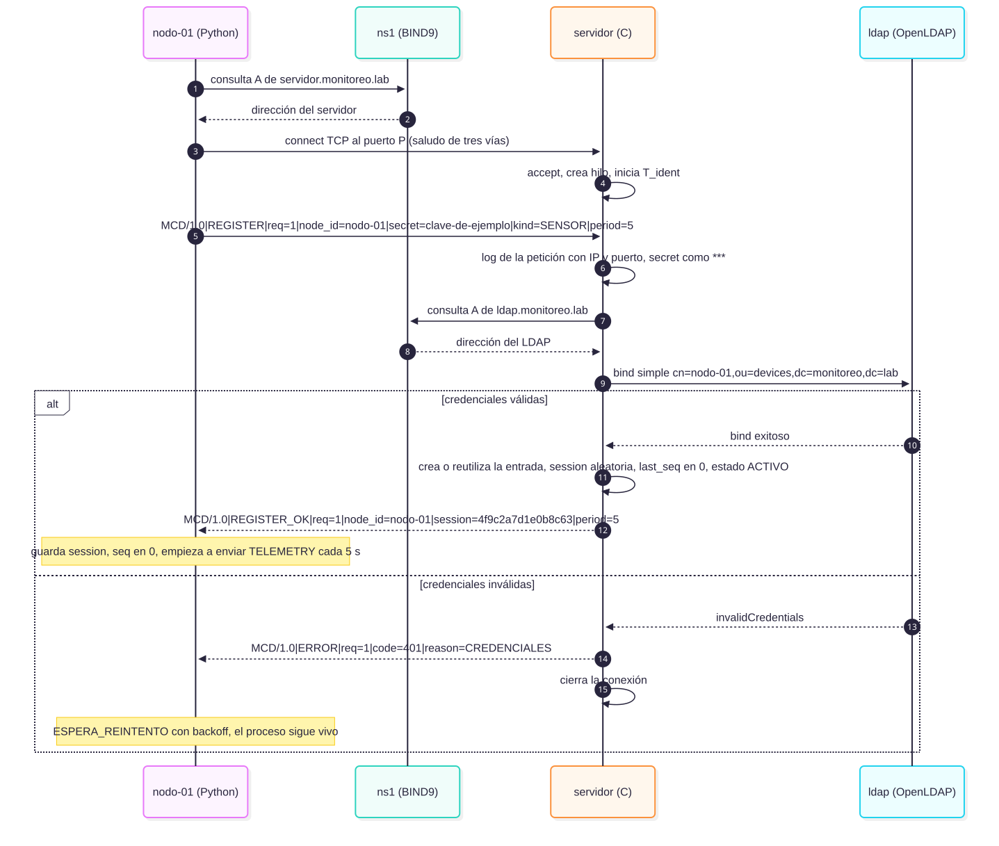

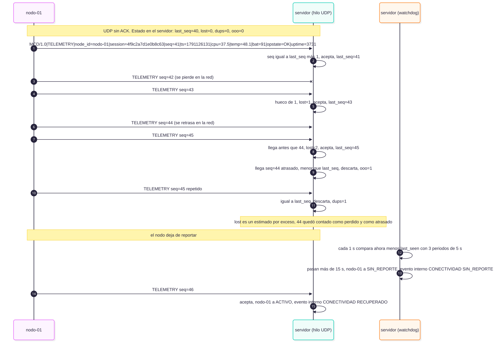

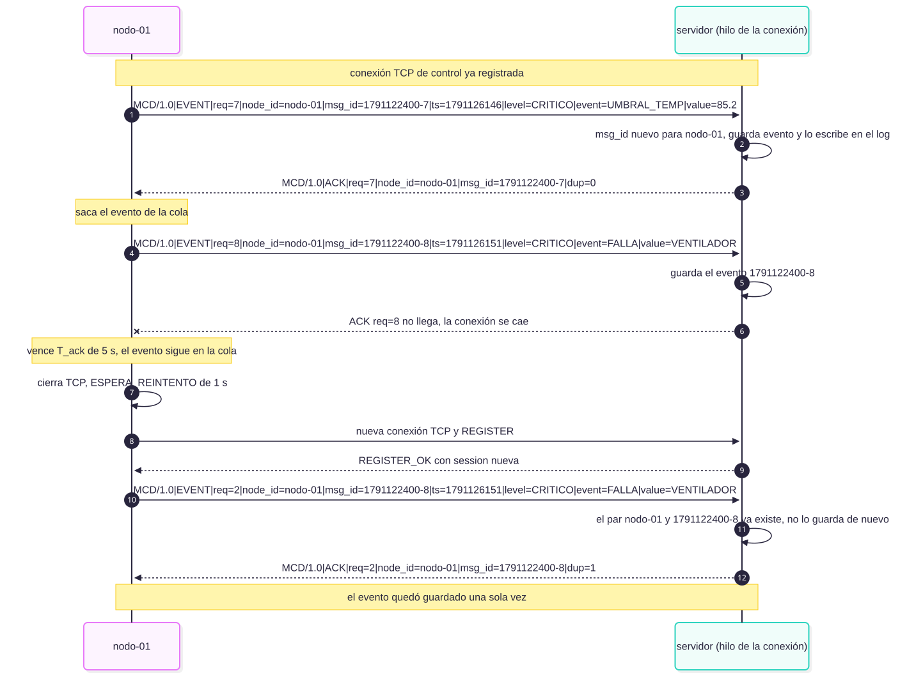

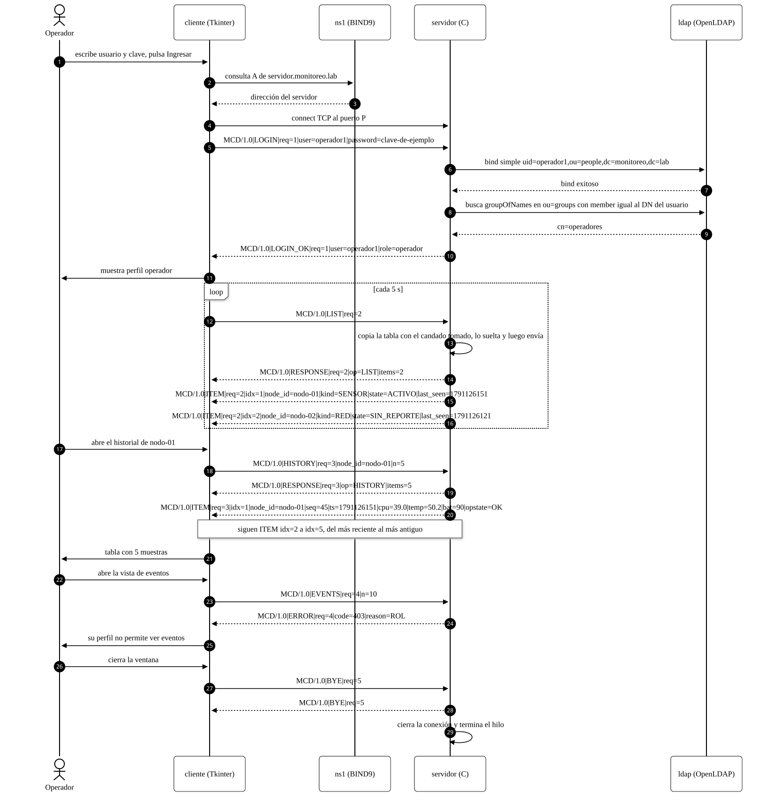

## Manejo de fallos

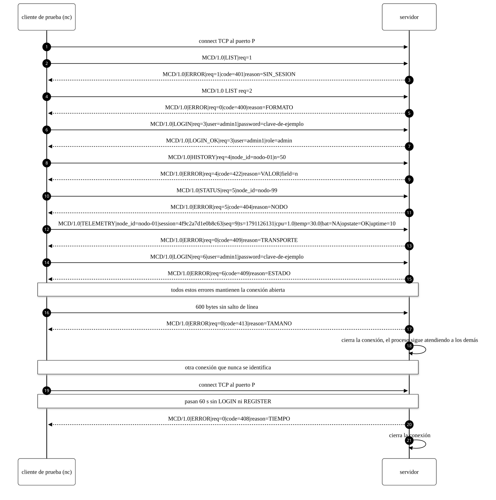

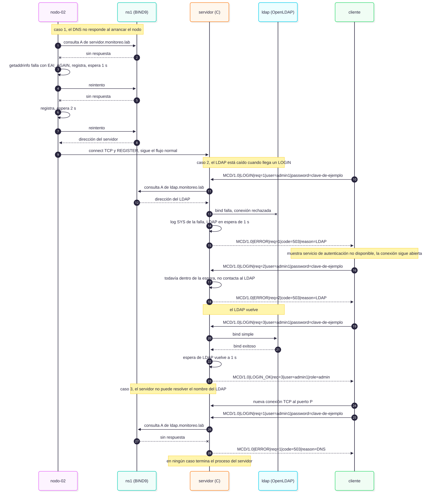
