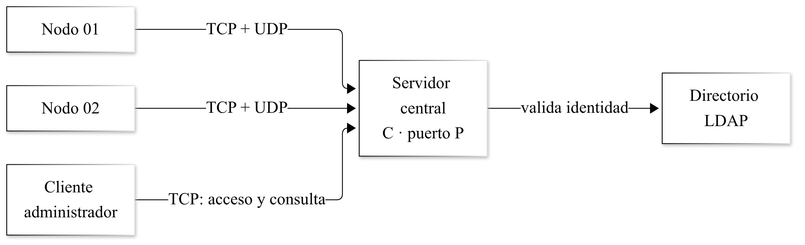
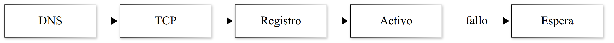
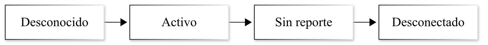
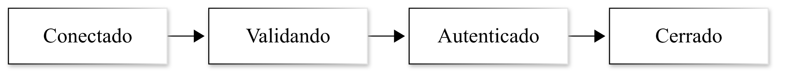
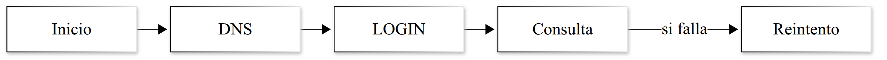

# Sistema de monitoreo y control distribuido

**Propuesta de diseño y arquitectura · Fase 1**  
ST0255 Telemática · Universidad EAFIT  
Emmanuel Hernández · 2026-2

**Repositorio:** https://github.com/Pacha-e/monitoreo-telematica  
*Esta revisión del PDF y sus cinco diagramas son archivos locales todavía no publicados en ese repositorio.*

---

## 1. Descripción general del problema

Una organización necesita supervisar equipos distribuidos. Cada nodo informa periódicamente su estado (por ejemplo, CPU, temperatura y batería) y avisa cuando ocurre un evento importante. Una muestra aislada se puede perder porque pronto llegará otra; un evento crítico, en cambio, debe quedar registrado. El servidor reúne la información y responde a quienes administran la red. Los clientes no se comunican con los nodos (Universidad EAFIT, 2026).

Esta primera entrega define la arquitectura y el intercambio preliminar de mensajes. No presenta una implementación ni resultados de pruebas.

## 2. Arquitectura propuesta

El servidor central recibe los datos de **dos nodos como mínimo** y atiende las consultas de uno o más clientes. Los nodos usan TCP para registrarse y reportar eventos; envían su telemetría por UDP. Los clientes se autentican y consultan por TCP. El servidor escucha ambos transportes en el puerto configurable `P`, valida identidades en un directorio LDAP y conserva el estado e historial reciente de cada nodo.



*Figura 1.* Las dos flechas «TCP + UDP» representan el tráfico de **cada** nodo: registro y eventos por TCP, telemetría por UDP. El cliente solo usa TCP. La resolución DNS se omite de la figura para evitar cruces: **nodos, cliente y servidor resuelven por nombre los servicios que necesitan**. No se codifican direcciones IP; una falla DNS se registra y se reintenta sin finalizar el proceso.

El servidor se proyecta en C con sockets Berkeley, acepta conexiones TCP concurrentes y recibe datagramas UDP. Su interfaz de ejecución será `./servidor <puerto> <archivoDeLogs>`; el log incluirá IP y puerto de origen sin registrar secretos. Los nodos y el cliente pueden implementarse en Python. Son decisiones de diseño para las fases posteriores, no funcionalidad ya construida.

## 3. Entidades participantes

| Entidad | Función y comunicación |
|:--|:--|
| Nodo 01 y nodo 02 | Registrarse, enviar muestras y reportar eventos al servidor; consultar DNS para localizarlo. |
| Servidor central | Mantener último estado e historial; confirmar eventos y responder consultas; consultar LDAP y DNS. |
| Cliente administrador | Autenticarse, visualizar el estado y al menos cinco datos históricos por nodo; hablar solo con el servidor. |
| DNS | Resolver nombres del servidor y del directorio; evita direcciones fijas en el código. |
| LDAP | Validar nodos y usuarios; asignar perfiles de operador o administrador. Solo el servidor consulta el directorio. |

El servidor distingue al operador, que consulta estados e historiales, del administrador, que además consulta eventos. La interfaz propuesta es sencilla; los permisos los aplica el servidor, no el programa de visualización.

## 4. Tipos de mensajes

El protocolo de aplicación se llama **MCD/1.0**. Las operaciones exigidas en el enunciado quedan cubiertas así:

| Operación | Petición → respuesta | Transporte |
|:--|:--|:--|
| Registrar un nodo | `REGISTER` → `REGISTER_OK` o `ERROR` | TCP |
| Informar una muestra | `TELEMETRY` → sin respuesta | UDP |
| Informar un evento | `EVENT` → `ACK` o `ERROR` | TCP |
| Iniciar sesión | `LOGIN` → `LOGIN_OK` o `ERROR` | TCP |
| Consultar | `LIST`, `STATUS`, `HISTORY` o `EVENTS` → `RESPONSE` y cero o más `ITEM`; o `ERROR` | TCP |
| Cerrar conexión | `BYE` → `BYE` | TCP |

`LIST` enumera nodos; `STATUS` devuelve su último estado; `HISTORY` entrega muestras recientes; `EVENTS` consulta eventos para el perfil autorizado. `ERROR` indica el motivo de rechazo. La muestra UDP no se confirma: si se pierde, la siguiente la reemplaza. En cambio, `ACK` confirma que el servidor **guardó** el evento, no solo que llegaron sus bytes.

## 5. Sintaxis preliminar

Cada mensaje es una línea ASCII terminada en `LF`, de hasta **512 bytes, incluido el salto de línea**:

```text
MCD/1.0|TIPO|clave=valor|clave=valor
```

En la línea mostrada, el `LF` va después del último valor. `|` separa campos y `=` separa clave y valor; no se admiten esos delimitadores dentro de los valores. Las claves no se repiten. En TCP el receptor acumula bytes hasta `LF`: una llamada a `recv` puede entregar media línea o varias. En UDP cada datagrama contiene una única línea. Los mensajes que superen el límite o tengan una forma inválida se rechazan.

Los campos compartidos son `req` (identifica una petición TCP y su respuesta), `node_id` (nodo), `session` (sesión válida), `seq` (orden de muestras), `msg_id` (identificador estable de evento) y `ts` (hora del dato). Ejemplos **esquemáticos**; cada renglón transmitido termina en `LF`:

```text
MCD/1.0|REGISTER|req=1|node_id=nodo-01|secret=clave-de-ejemplo|kind=SENSOR|period=5
MCD/1.0|TELEMETRY|node_id=nodo-01|session=4f9c2a7d1e0b8c63|seq=41|ts=1791126131|cpu=37.5|temp=48.1|bat=91|opstate=OK|uptime=3731
MCD/1.0|EVENT|req=7|node_id=nodo-01|msg_id=1791122400-7|ts=1791126146|level=CRITICO|event=UMBRAL_TEMP|value=85.2
```

La sintaxis detallada de cada tipo y los rangos de sus campos quedan en la especificación del repositorio (`docs/protocolo/MCD-1.0.md`); estos ejemplos ilustran el diseño preliminar, no claves reales.

## 6. Reglas básicas de comunicación

1. El nodo resuelve el nombre del servidor, abre TCP y envía `REGISTER`. Solo tras `REGISTER_OK` puede informar telemetría o eventos; el servidor liga la sesión al nodo registrado.
2. Cada `period`, el nodo envía una muestra UDP con su `session` y `seq`. El servidor descarta sesiones desconocidas, duplicados y muestras atrasadas; conserva la muestra válida más reciente y el historial. Si transcurren más de tres periodos sin muestra válida, marca `SIN_REPORTE`.
3. El nodo envía eventos por su conexión TCP. El servidor guarda cada `msg_id` una vez y devuelve `ACK`. Si la conexión cae antes de recibirlo, el nodo se registra de nuevo y reenvía **el mismo** `msg_id`; el servidor evita duplicarlo y vuelve a confirmar.
4. El cliente envía `LOGIN` y espera `LOGIN_OK` antes de consultar. El servidor valida en LDAP y comprueba el perfil en cada consulta. `RESPONSE` precede a los `ITEM`; una petición incorrecta recibe `ERROR`.
5. Si falla DNS, LDAP o la conexión, los procesos siguen vivos. El emisor reintenta con espera acotada; el servidor informa la indisponibilidad cuando ya hay una conexión a la que pueda responder. `BYE` cierra ordenadamente una sesión TCP.

Estas reglas definen las decisiones principales sin trasladar a esta entrega todos los temporizadores y códigos de error de la especificación completa.

## 7. Máquinas de estado

Las flechas muestran **la ruta principal**, sin cruces de vuelta. Los retornos y errores se expresan debajo de cada figura para que no queden escondidos tras etiquetas.

**Nodo.**



*Figura 2.* Un fallo en DNS, TCP o registro también lleva a `Espera`; al vencer el temporizador, el nodo vuelve a DNS y repite el registro. Mientras está `Activo`, envía muestras periódicas y eventos, esperando `ACK` para estos últimos.

**Nodo observado por el servidor.**



*Figura 3.* `REGISTER` válido lleva de `Desconocido` a `Activo`; la falta de muestras durante más de tres periodos lleva a `Sin reporte`. La flecha hacia `Desconectado` significa que se cerró TCP. Una muestra válida devuelve `Sin reporte` a `Activo`, y un TCP cerrado desde `Activo` también lleva directo a `Desconectado`. El historial se conserva.

**Sesión administrativa en el servidor.**



*Figura 4.* Un `LOGIN` rechazado permite otro intento hasta el límite previsto; una consulta anterior a `LOGIN_OK` recibe `ERROR`. La inactividad también puede cerrar una sesión autenticada.

**Cliente administrador.**



*Figura 5.* Una falla de red en DNS, durante `LOGIN` o en consulta lleva a `Reintento`: tras la espera vuelve a resolver el nombre y a iniciar sesión. Si el servidor rechaza las credenciales, el cliente vuelve al formulario, no reenvía la misma clave automáticamente. Nunca consulta sin autenticarse. Cada figura tiene su fuente Mermaid (`.mmd`) y su imagen en `docs/diagramas/entrega1-clara/` del árbol local. El repositorio enlazado en portada conserva la versión previa hasta que se autorice publicar esta revisión.

## 8. Análisis preliminar de TCP y UDP

La elección depende del mensaje, no de que un transporte sea «mejor» en general (Universidad EAFIT, 2026):

| Criterio | Muestras periódicas | Registro, eventos y consultas |
|:--|:--|:--|
| Frecuencia y tamaño | Frecuentes y pequeños | Registro ocasional, eventos esporádicos; respuestas de tamaño variable |
| Pérdida y orden | Una muestra aislada es reemplazable; se descarta la atrasada | No debe perderse un registro, evento ni respuesta; importa el orden |
| Conexión y retardo | No necesita conexión; prioriza el dato reciente | Reutiliza la sesión TCP y tolera el tiempo de retransmisión |
| Transporte | **UDP**; sin ACK ni reenvío de muestras | **TCP**; evento con `ACK` de aplicación y `msg_id` |

TCP entrega bytes fiables y ordenados, pero no indica si la aplicación **procesó** un evento; de ahí el `ACK` y la deduplicación tras reconectar (Eddy, 2022). UDP no garantiza entrega ni orden (Postel, 1980). Para la telemetría eso es aceptable: `seq` permite descartar copias y detectar huecos, y un temporizador advierte si dejan de llegar muestras. No se construyen retransmisiones UDP ni se intenta recrear TCP.

## Referencias

Eddy, W. (Ed.). (2022). *Transmission Control Protocol (TCP)* (RFC 9293). RFC Editor. https://www.rfc-editor.org/rfc/rfc9293

Postel, J. (1980). *User Datagram Protocol* (RFC 768). RFC Editor. https://www.rfc-editor.org/rfc/rfc768

Universidad EAFIT. (2026). *Sistema de monitoreo y control distribuido* [Enunciado del proyecto]. ST0255 Telemática: Internet, Arquitectura y Protocolos.
