# Sistema de monitoreo y control distribuido

## Propuesta de diseño y arquitectura (Fase 1)

ST0255 Telemática: Internet, Arquitectura y Protocolos

Emmanuel Hernández

Profesor: Jaime A. Vergara

Universidad EAFIT, semestre 2026-2

4 de octubre de 2026\
Repositorio del proyecto: https://github.com/Pacha-e/monitoreo-telematica

---

## Contenido

1. Descripción general del problema
2. Arquitectura propuesta
3. Entidades participantes
4. Tipos de mensajes
5. Sintaxis preliminar
6. Reglas básicas de comunicación
7. Máquinas de estado
8. Análisis preliminar sobre el uso de TCP y UDP

Referencias

Anexo A. Diagramas

## 1. Descripción general del problema

Una organización tiene equipos repartidos por su infraestructura (sensores, equipos de red, dispositivos IoT) que necesita supervisar de forma remota. Cada equipo, que aquí llamo nodo, le informa a un servidor central dos tipos de información. La primera es su estado periódico: uso de CPU, temperatura, nivel de batería, estado operativo y tiempo encendido. La segunda son eventos críticos: fallas, superación de umbrales, pérdida de conectividad o cambios importantes de estado. La diferencia entre ambas es el punto de partida de todo el diseño: el enunciado tolera perder alguna muestra periódica siempre que el dato se siga actualizando, pero perder un evento crítico tiene consecuencias (Universidad EAFIT, 2026c).

El servidor central recibe lo que llega de varios nodos, mantiene una foto actualizada de la infraestructura (qué nodos existen, cuáles reportan y cuál fue su último estado), guarda un historial reciente y responde a los clientes de administración que consultan esa información. Los clientes no hablan con los nodos; todo pasa por el servidor.

El problema de fondo, y lo que esta fase evalúa, es diseñar el protocolo de aplicación que coordina esa comunicación y decidir, para cada tipo de mensaje, qué servicio de transporte le conviene. El sistema además debe integrarse con servicios reales de Internet: resolución de nombres en lugar de direcciones fijas (requisito 4) y autenticación centralizada en lugar de una lista de usuarios dentro del programa (requisito 6).

Esta entrega es la Fase 1: diseño y arquitectura, todavía sin código. La especificación completa del protocolo (`docs/protocolo/MCD-1.0.md`), la matriz de trazabilidad con todos los requisitos y los diagramas de secuencia están en el repositorio; aquí presento lo que la fase pide. El trabajo tiene un solo autor: Emmanuel Hernández.

## 2. Arquitectura propuesta

El diseño sigue un modelo cliente-servidor estricto: el servidor es el único que escucha y los nodos y clientes siempre inician. Eso cumple el requisito 2 (no hay comunicación directa entre nodos y clientes) y funciona aunque los nodos estén detrás de NAT. El servidor abre un solo número de puerto `P` en TCP y en UDP, porque el enunciado contempla un único parámetro "puerto"; el primer mensaje de cada conexión dice de qué se trata: `REGISTER` para un nodo, `LOGIN` para un cliente. Cada nodo mantiene una conexión TCP persistente desde su registro: por ahí viajan sus eventos y el servidor detecta su desconexión cuando `recv()` devuelve 0.

| Máquina lógica | Componente | Qué escucha |
|---|---|---|
| `servidor.monitoreo.lab` | Servidor central en C | Puerto `P` en TCP y en UDP (por ejemplo, 5050) |
| `ns1.monitoreo.lab` | BIND9 con la zona `monitoreo.lab` | 53 en UDP y TCP |
| `ldap.monitoreo.lab` | OpenLDAP con base `dc=monitoreo,dc=lab` | 389 TCP |
| Máquinas de los nodos | `nodo-01` y `nodo-02` en Python | Nada; solo inician conexiones |
| Máquina del administrador | Cliente Python con Tkinter | Nada; solo inicia conexiones |

Son máquinas lógicas: en la práctica el DNS y el LDAP pueden compartir VM, como también los dos nodos, sin que cambie el diseño, porque todos se encuentran por nombre. El diagrama completo está en el Anexo A.

**Resolución de nombres (requisito 4).** Ninguna dirección IP vive en el código. La zona `monitoreo.lab` en BIND9 tiene registros para `ns1`, `servidor` y `ldap`, con el modelo de Mockapetris (1987a, 1987b). Los nodos y el cliente resuelven `servidor.monitoreo.lab` con `getaddrinfo` en cada intento de conexión; el servidor resuelve `ldap.monitoreo.lab` antes de cada verificación y escucha con `getaddrinfo` y `AI_PASSIVE`. Si la resolución falla (`EAI_AGAIN`, `socket.gaierror`), se registra, se reintenta con espera creciente y el proceso sigue vivo, como exige el enunciado.

**Autenticación (requisito 6).** Los usuarios y los nodos se validan contra OpenLDAP, el servicio de directorio visto en clase (Sermersheim, 2006; Universidad EAFIT, 2026a). Los usuarios humanos (`ou=people`) se autentican con un *bind* simple y su perfil sale del grupo al que pertenecen (`ou=groups`): `cn=admins` da perfil `admin` y `cn=operadores` da `operador`. Los nodos (`ou=devices`) usan el mismo mecanismo, así un equipo no dado de alta no puede registrarse. El servidor no guarda contraseñas: pregunta al LDAP cada vez.

**Concurrencia (requisitos 3f y 10).** El servidor atiende con un hilo por conexión TCP (hasta 64), un hilo receptor de UDP y un hilo watchdog que vigila los temporizadores, usando `pthread`, que el enunciado permite. Hay dos mutex: uno para la tabla de nodos, historiales y eventos, y otro para el log. Si un hilo necesita ambos, toma primero el de la tabla y luego el del log, nunca al revés, y las operaciones lentas (LDAP, DNS, `send`) se hacen sin el mutex tomado.

**Servidor y logging.** El servidor se escribe en C con la API de sockets Berkeley y `pthread`, se compila con `gcc` y `Makefile`, y se ejecuta como `./servidor <puerto> <archivoDeLogs>`. Escribe cada petición y respuesta en consola y en el archivo de logs, con la IP y el puerto de origen de cada mensaje (Universidad EAFIT, 2026d).

## 3. Entidades participantes

| Entidad | Lenguaje | Papel | Habla con | Transporte |
|---|---|---|---|---|
| Servidor central | C | Registra nodos, recibe telemetría y eventos, mantiene estado e historial, autentica y responde consultas | Nodos, clientes, LDAP, DNS | TCP y UDP en `P` |
| Nodo | Python | Se registra, envía telemetría cada `period` segundos y notifica eventos | Servidor, DNS | TCP y UDP hacia `P` |
| Cliente de administración | Python con Tkinter | Autentica a una persona, muestra estado actual, historial y, para `admin`, los eventos | Servidor, DNS | TCP hacia `P` |
| Servidor DNS | BIND9 | Resuelve los nombres de la zona `monitoreo.lab` | Todos | UDP/TCP 53 |
| Directorio LDAP | OpenLDAP | Guarda usuarios, nodos y grupos de perfil | Solo el servidor | TCP 389 |

Los usuarios humanos tienen uno de dos perfiles. El `operador` ve la lista de nodos, el estado de cada uno y su historial; el `admin` además ve la lista de eventos, incluidos los que genera el propio servidor cuando un nodo deja de reportar. El cliente es uno solo en las pruebas, pero el diseño admite varios concurrentes.

## 4. Tipos de mensajes

El protocolo se llama MCD/1.0 (Monitoreo y Control Distribuido). El requisito 7 pide mensajes para siete operaciones; así las cubre el protocolo:

| Operación del requisito 7 | Mensajes | Transporte |
|---|---|---|
| a) registro de un nodo | `REGISTER` | TCP |
| b) información periódica de estado | `TELEMETRY` | UDP |
| c) envío de un evento | `EVENT` | TCP |
| d) confirmación o respuesta | `REGISTER_OK`, `ACK`, `LOGIN_OK`, `BYE` | TCP |
| e) consulta de información | `LIST`, `STATUS`, `HISTORY`, `EVENTS` (previo `LOGIN`) | TCP |
| f) respuesta a una consulta | `RESPONSE` seguido de líneas `ITEM` | TCP |
| g) reporte de errores | `ERROR` | TCP; por UDP solo el 404 |

En total son 15 tipos. El detalle de campos de cada uno está en la sección 5 de la especificación; los intercambios completos, con sus diagramas de secuencia, en la sección 14 de la misma. Los flujos principales son cinco:

1. **Registro:** el nodo resuelve el nombre del servidor, abre TCP, envía `REGISTER` y el servidor valida contra LDAP; responde `REGISTER_OK` con un token de sesión.
2. **Telemetría:** cada `period` segundos el nodo envía un datagrama `TELEMETRY` con el token y un número de secuencia; no hay respuesta.
3. **Evento:** el nodo envía `EVENT` por su conexión TCP y espera `ACK`; si no llega, reconecta y reenvía con el mismo identificador, y el servidor no lo guarda dos veces.
4. **Consulta:** el cliente envía `LOGIN`, el servidor verifica en LDAP y responde con el perfil; luego consulta cada 5 segundos.
5. **Errores y fallas:** el servidor responde ante mensajes inválidos, temporizadores vencidos y caídas de DNS o LDAP sin terminar nunca el proceso.

## 5. Sintaxis preliminar

Cada mensaje es una línea de texto ASCII:

```
MCD/1.0|TIPO|clave=valor|clave=valor|...\n
```

Reglas principales (la gramática ABNF completa está en la especificación, sección 4.2, siguiendo la notación de Crocker y Overell (2008) con la extensión de Kyzivat (2014)):

- Empieza con la versión `MCD/1.0` y luego el tipo en mayúsculas.
- Los campos son pares `clave=valor` separados por `|`; las claves van en minúscula.
- Los valores solo pueden tener letras ASCII, dígitos, punto, guion, guion bajo y dos puntos. No se permiten `|`, `=`, espacios ni caracteres fuera de ASCII; si hiciera falta texto libre, se usa un código enumerado.
- El mensaje termina en un único `\n` y mide como máximo 512 bytes, contando ese salto.
- Hasta 16 campos por mensaje, sin claves repetidas y de 1 a 64 caracteres por valor.

Ejemplos:

```
MCD/1.0|REGISTER|req=1|node_id=nodo-01|secret=clave-de-ejemplo|kind=SENSOR|period=5
MCD/1.0|TELEMETRY|node_id=nodo-01|session=4f9c2a7d1e0b8c63|seq=41|ts=1791126131|cpu=37.5|temp=48.1|bat=91|opstate=OK|uptime=3731
MCD/1.0|ERROR|req=4|code=422|reason=VALOR|field=n
```

Elegí texto y no binario porque puedo probar el servidor con `nc` antes de tener los clientes y en Wireshark cada mensaje se lee sin decodificador, como en HTTP o SMTP. El delimitador `\n` es necesario porque TCP entrega un flujo de bytes, no mensajes: hay que saber dónde termina cada uno cuando un `recv()` trae medio mensaje o varios juntos. Los 512 bytes de máximo dan margen de sobra: el mensaje más grande posible (un `ITEM` de estado con todos los campos al tope) mide 245 bytes, y el datagrama completo (540 bytes con encabezados IP y UDP) nunca se fragmenta en Ethernet.

Campos que se repiten en varios mensajes:

| Campo | Para qué sirve |
|---|---|
| `req` | Número de petición en una conexión TCP; la respuesta lo copia |
| `node_id` | Nombre del nodo, igual al registrado en LDAP |
| `session` | Token de 16 caracteres hexadecimales entregado al registrar |
| `seq` | Número de secuencia de la telemetría, de a 1 por sesión |
| `msg_id` | Identidad de un evento, de la forma `<arranque>-<contador>` |
| `ts` | Hora en segundos epoch según quien genera el dato |

## 6. Reglas básicas de comunicación

Las reglas completas, con algoritmos, están en la sección 7 de la especificación. Las esenciales:

1. El servidor es el único que escucha; nodos y clientes inician siempre.
2. La primera petición en una conexión TCP debe ser `REGISTER` (nodo) o `LOGIN` (cliente). Antes de eso, una consulta o un evento reciben 401 `SIN_SESION`, y una conexión no puede cambiar de identidad.
3. Ningún nodo envía telemetría ni eventos antes de su `REGISTER_OK`; ningún cliente consulta antes de su `LOGIN_OK`.
4. Toda petición TCP lleva `req` y toda respuesta lo copia. Cada entidad envía una petición a la vez y espera la respuesta antes de la siguiente.
5. La telemetría solo va por UDP y no se responde. El servidor la acepta solo con el `session` vigente: un `seq` repetido se descarta como duplicado, uno menor al último como atrasado, y un salto suma al contador de perdidos.
6. Cada evento se confirma con `ACK` solo después de guardarlo. El servidor recuerda los últimos 64 `msg_id` por nodo: si llega uno repetido, responde `ACK` con `dup=1` y no lo guarda otra vez.
7. Un nodo pasa a `SIN_REPORTE` si pasan más de 3 periodos sin telemetría válida, y vuelve a `ACTIVO` con la siguiente muestra que llegue.
8. Si el servidor responde 404 por UDP, el nodo se registra de nuevo; así el sistema se recupera solo si el servidor se reinicia.
9. Cualquier error se responde con `ERROR`, con un código numérico y un motivo enumerado: 400 formato o versión, 401 credenciales o falta de sesión, 403 rol insuficiente, 404 nodo o sesión inexistente, 408 temporizador vencido, 409 mensaje en estado o transporte que no corresponde, 413 tamaño excedido, 422 campo o valor inválido, 500 falla interna y 503 LDAP, DNS o capacidad. Los 400 y 422 no cierran la conexión, salvo cinco seguidos; los 413 sí cierran, porque ya no se sabe dónde empieza el siguiente mensaje. La especificación fija además un orden único de validación para que dos implementaciones respondan igual ante el mismo mensaje.
10. Ninguna falla de DNS, LDAP o red termina un proceso. Todo reintento usa la misma espera creciente: 1, 2, 4, 8, 16 y 30 segundos.
11. El cierre ordenado es con `BYE`, que el servidor contesta con otro `BYE` antes de cerrar.

## 7. Máquinas de estado

Hay cuatro máquinas. Cada una tiene su diagrama en el Anexo A y su tabla de transiciones completa en la sección 9 de la especificación, que es la referencia normativa.

- **Nodo:** pasa por resolución DNS, conexión, registro y operación. Una falla lleva a `ESPERA_REINTENTO` con espera creciente; un evento espera su `ACK` sin detener la telemetría periódica.
- **Nodo visto por el servidor:** empieza como `DESCONOCIDO`, queda `ACTIVO` tras el registro, pasa a `SIN_REPORTE` si el watchdog cuenta más de tres periodos sin datos y queda `DESCONECTADO` si se cierra su TCP. El historial y los eventos se conservan.
- **Sesión administrativa en el servidor:** exige identificarse en 60 s (`T_ident`), valida el `LOGIN` contra LDAP con tres intentos, y solo permite consultas al perfil autorizado; cierra por `BYE`, por inactividad de 5 minutos o por errores de formato seguidos.
- **Cliente de administración:** pide credenciales, resuelve el servidor, inicia sesión, consulta cada 5 segundos y reconecta con espera creciente si la red falla; un 401 o 403 lo devuelve al formulario.

## 8. Análisis preliminar sobre el uso de TCP y UDP

El enunciado pide analizar cada tipo de mensaje según criterios concretos y no declarar simplemente un protocolo "mejor" (Universidad EAFIT, 2026b, 2026c). Agrupo los mensajes en cuatro flujos, porque los de un mismo flujo comparten necesidades:

| Criterio | Registro (`REGISTER`, `REGISTER_OK`) | Telemetría (`TELEMETRY`) | Eventos (`EVENT`, `ACK`) | Consultas (`LOGIN`, `LIST`, `STATUS`, `HISTORY`, `EVENTS`, `RESPONSE`, `ITEM`, `BYE`) |
|---|---|---|---|---|
| Frecuencia | Una por arranque o reconexión | Cada `period` segundos por nodo | Esporádica | Un `LOGIN` por sesión; consultas cada 5 s |
| Tamaño | 84 y 76 bytes en el ejemplo; máximo 166 | 129 bytes en el ejemplo; máximo 182 | 113 y 60 bytes; máximo 188 | Consultas de 19 a 76 bytes; respuestas de 1 `RESPONSE` más hasta 32 `ITEM` de hasta 245 bytes |
| Criticidad | Alta: sin registro no hay sesión | Baja por muestra: la siguiente la reemplaza | Alta: una alarma no se puede perder | Alta: la persona va a decidir con ese dato |
| Tolerancia a pérdidas | Ninguna | Alta, si es ocasional | Ninguna | Ninguna |
| Necesidad de orden | Sí, antes que cualquier evento | No: una muestra atrasada se descarta | Sí, entre eventos de un nodo | Sí: `RESPONSE` precede a sus `ITEM` |
| Confiabilidad | Sí | No | Sí, y confirmación de procesado | Sí |
| Mantener conexión | Sí: la conexión identifica al nodo | No | Sí, reutiliza la del registro | Sí: la sesión es la conexión |
| Ante retardos | Se esperan unos segundos (`T_resp` de 5 s) | Un dato retrasado pierde valor | Se tolera; importa que llegue una vez | Se toleran segundos; luego se reconecta |
| Ante pérdida | TCP retransmite; si cae, se registra de nuevo | Se cuenta y se sigue | TCP retransmite; sin `ACK`, reenvío con el mismo `msg_id` | TCP retransmite; si cae, se reconecta y repite |
| Transporte elegido | TCP | UDP | TCP con `ACK` de aplicación | TCP |

**Telemetría por UDP.** Es exactamente el caso que el enunciado describe como tolerable a pérdida ocasional. Con TCP, una muestra perdida se retransmitiría y las siguientes quedarían detenidas detrás de ella; es lo contrario de lo que quiero, porque el dato nuevo vale más que el viejo (Postel, 1980). UDP además evita mantener una conexión por nodo para este flujo y cada muestra cabe en un datagrama: 129 bytes de mensaje más 28 de encabezados cada 5 segundos son unos 31 bytes por segundo por nodo. De los mecanismos que el enunciado enumera para cuando UDP necesita confiabilidad, uso solo los que este flujo pide: identificación del mensaje (`node_id`, `session`, `seq`), un temporizador en el servidor (el watchdog que marca `SIN_REPORTE`), detección de duplicados y control del desorden (comparación de `seq`). No uso confirmación ni retransmisión: una muestra retransmitida llegaría vieja. Con eso no estoy reimplementando TCP, que es justo lo que el enunciado pide evitar.

**Eventos por TCP.** Necesitan llegar, llegar una sola vez y en orden. Por UDP tendría que construir confirmaciones, temporizadores, retransmisión y deduplicación: prácticamente rehacer TCP. TCP ya da confiabilidad y orden (Eddy, 2022); lo único que no resuelve es que el servidor guarde el evento y la conexión caiga antes de que el nodo reciba la confirmación. Para ese caso agrego solo dos cosas: un `ACK` que significa "procesado", no solo "recibido", y un `msg_id` estable para que el reenvío no se guarde dos veces. El costo es bajo: los eventos son esporádicos y la conexión ya está abierta.

**Registro, autenticación y consultas por TCP.** Estos flujos crean o leen estado y siguen un patrón de petición-respuesta; necesitan las tres garantías de TCP y además la conexión misma representa algo: la sesión autenticada del cliente o la presencia del nodo (Postel, 1981).

**Resultado.** La arquitectura combina TCP y UDP, una de las tres opciones del enunciado: UDP solo para la telemetría y TCP para todo lo demás, con los mecanismos mínimos de aplicación donde hacen falta y justificados por el comportamiento de cada flujo.

## Referencias

Crocker, D. (Ed.), & Overell, P. (2008). *Augmented BNF for syntax specifications: ABNF* (RFC 5234). RFC Editor. https://www.rfc-editor.org/rfc/rfc5234

Eddy, W. (Ed.). (2022). *Transmission Control Protocol (TCP)* (RFC 9293). RFC Editor. https://www.rfc-editor.org/rfc/rfc9293

Kyzivat, P. (2014). *Case-sensitive string support in ABNF* (RFC 7405). RFC Editor. https://www.rfc-editor.org/rfc/rfc7405

Mockapetris, P. (1987a). *Domain names: Concepts and facilities* (RFC 1034). RFC Editor. https://www.rfc-editor.org/rfc/rfc1034

Mockapetris, P. (1987b). *Domain names: Implementation and specification* (RFC 1035). RFC Editor. https://www.rfc-editor.org/rfc/rfc1035

Postel, J. (1980). *User Datagram Protocol* (RFC 768). RFC Editor. https://www.rfc-editor.org/rfc/rfc768

Postel, J. (1981). *Transmission Control Protocol* (RFC 793). RFC Editor. https://www.rfc-editor.org/rfc/rfc793

Sermersheim, J. (Ed.). (2006). *Lightweight Directory Access Protocol (LDAP): The protocol* (RFC 4511). RFC Editor. https://www.rfc-editor.org/rfc/rfc4511

Universidad EAFIT. (2026a). *Capa de aplicación: DNS, HTTP, SMTP, LDAP y NFS* [Material de curso]. ST0255 Telemática: Internet, Arquitectura y Protocolos.

Universidad EAFIT. (2026b). *Capa de transporte* [Material de curso]. ST0255 Telemática: Internet, Arquitectura y Protocolos.

Universidad EAFIT. (2026c). *Enunciado del proyecto "Sistema de monitoreo y control distribuido"* [Material de curso]. ST0255 Telemática: Internet, Arquitectura y Protocolos.

Universidad EAFIT. (2026d). *Programación de sockets* [Material de curso]. ST0255 Telemática: Internet, Arquitectura y Protocolos.

# Anexo A. Diagramas

Los diagramas se generaron con Mermaid; las fuentes editables y las exportaciones están en `docs/diagramas/` del repositorio. Las tablas de transición de la sección 9 de la especificación son la referencia normativa. Las máquinas largas se muestran en partes para que cada una sea legible al tamaño de página.

## Arquitectura de despliegue


## Máquina de estados del nodo

### Parte 1: arranque y resolución.


### Parte 2: registro.


### Parte 3: operación, eventos y cierre.


Al vencer cada `period` el nodo envía su telemetría. Un evento pasa por `ESPERANDO_ACK` sin detener la telemetría; el evento espera su `ACK` en la cola y, si debe reconectar, se reenvía con el mismo `msg_id` (la continuación está en la parte 1). El detalle de cada transición está en la sección 9 de la especificación.

## Estado del nodo visto por el servidor

### Parte 1: registro y vigilancia.


La telemetría de un origen desconocido recibe 404 `NODO` a lo sumo cada 5 segundos. Cada `TELEMETRY` aceptada actualiza el estado y el historial; una duplicada o atrasada se descarta y se cuenta. El watchdog marca `SIN_REPORTE` tras 3 periodos sin datos y genera un evento `CONECTIVIDAD`.

### Parte 2: desconexión y reenganche.


## Sesión administrativa en el servidor

### Parte 1: identificación y autenticación.


Sin `LOGIN`, una consulta o un `EVENT` reciben 401 `SIN_SESION`. Los errores 400 y 422 no cierran la conexión, salvo cinco seguidos. `T_ident` da 60 segundos para identificarse. El 503 de LDAP o DNS no cuenta como fallo de ingreso.

### Parte 2: sesión autenticada y cierre.


## Máquina de estados del cliente administrativo

### Parte 1: inicio y conexión.


Las fallas llevan a `ESPERA_REINTENTO`, con espera creciente de 1 a 30 segundos; al reconectar, el cliente repite el `LOGIN` con las credenciales que conserva en memoria.

### Parte 2: autenticación.


### Parte 3: consultas y cierre.


El refresco consulta cada 5 segundos. La respuesta `RESPONSE` con sus `ITEM` actualiza la ventana; un error 403, 404 o 422 solo se muestra y la consulta se repite en el siguiente ciclo.
